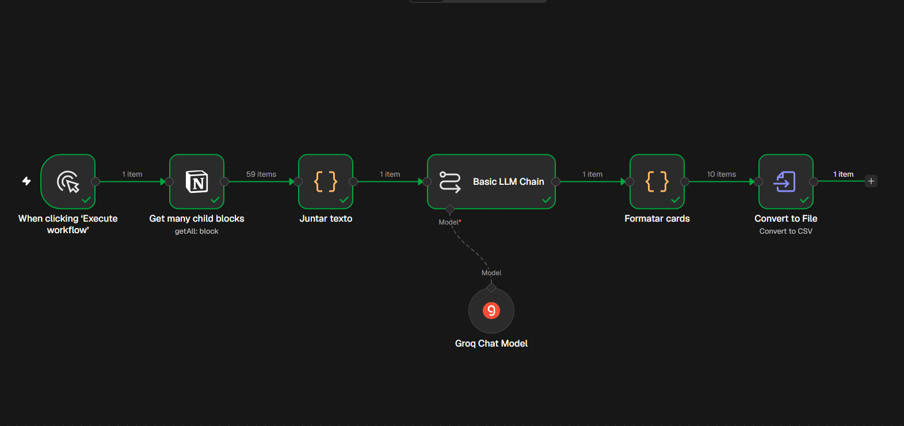

[README.md](https://github.com/user-attachments/files/34341751/README.md)
# Flashcards com IA: Notion → n8n → Anki

Automação que transforma anotações de aula do Notion em flashcards prontos para revisar no Anki, usando um modelo de linguagem (LLM) para gerar perguntas e respostas.

Criei este projeto para acelerar meus estudos na graduação em Defesa Cibernética: em vez de escrever cada flashcard à mão, o fluxo lê a página da aula e gera os cards em poucos segundos.



## Como funciona

```
[Disparo manual] → [Notion: lê os blocos da página da aula] → [Code: junta o texto]
→ [Basic LLM Chain + Groq Chat Model: gera os flashcards em JSON]
→ [Code: formata frente/verso] → [Convert to File: CSV] → importação no Anki
```

1. **Notion**: lê todos os blocos de texto da página da aula, incluindo blocos aninhados.
2. **Juntar texto**: um nó de código une o conteúdo em um único texto, tratando os dois formatos de saída do nó do Notion (simplificado e bruto da API).
3. **LLM (Groq, modelo `openai/gpt-oss-120b`)**: recebe um prompt com regras (uma ideia por card, resposta curta, usar somente informações das anotações, saída em JSON).
4. **Formatar cards**: extrai o array JSON da resposta do modelo, mesmo que venha com texto extra ou marcação markdown.
5. **Convert to File**: gera um CSV sem cabeçalho (`frente,verso`), pronto para importar no Anki como nota do tipo "Básico".


## Tecnologias

- [n8n](https://n8n.io) (Community Edition, self-hosted via Docker)
- API do Notion (integração interna, somente leitura)
- [Groq](https://console.groq.com) (camada gratuita)
- [Anki](https://apps.ankiweb.net)

## Como usar

1. Rode o n8n localmente (por exemplo, com Docker).
2. Importe o arquivo `flashcards-notion-anki.json` no n8n (menu de workflows → **Import from File**).
3. Crie as credenciais:
   - **Notion API**: crie uma conexão de desenvolvedor no Notion (token de API, permissão só de leitura) e adicione essa conexão à página que será lida.
   - **Groq**: gere uma chave em console.groq.com.
4. No nó do Notion, informe a URL da página da aula.
5. Execute o fluxo, baixe o CSV gerado no último nó e importe no Anki (separador: vírgula; tipo de nota: Básico).

## Limitações e próximos passos

- A camada gratuita da Groq tem limite de tokens por minuto, por isso o fluxo funciona melhor com uma aula por vez.
- Os cards gerados por IA devem ser revisados antes de estudar: o modelo pode simplificar ou errar.
- Próximos passos: disparar o fluxo automaticamente ao criar uma nova anotação no Notion e enviar os cards direto ao Anki (via AnkiConnect), sem passar pelo CSV.

## Segurança

Nenhuma chave de API ou token está incluído neste repositório. As credenciais ficam armazenadas somente na instância local do n8n.
